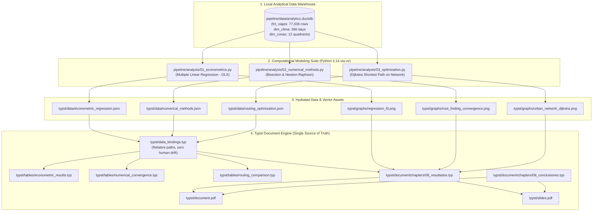

# MoviGo Research Paper: Master Completion Roadmap & Technical Specifications

**Document Version:** 3.0.0 (DataOps Architecture & Lean Curricular Integration)  
**Project:** Modelación del Impacto de la Tarifa Dinámica sobre la Tasa de Cancelación de Viajes en el Servicio MoviGo en Managua (2024)  
**Authors:** Br. Miranda Pérez, J. D.; Br. Aguilar Rodríguez, K. E.; Br. Oyarzo Morales, R. A.; Br. Medrano Dávila, L. D.  
**Tutor:** MSc. Gerardo Mendoza Jiménez  
**Central Repository Location:** `doc/paper_completion_roadmap.md`

---

## 1. Executive Summary & Context

This roadmap defines the complete, rigorous, and unambiguous implementation plan to finalize the undergraduate research paper on the **MoviGo** ride-hailing service in Managua, Nicaragua.

Following a thorough strategic re-alignment, the paper places its primary spotlight on **Data Engineering, DataOps, and Reproducibility Tools**:
- **Data Engineering / DataOps (Primary Spotlight):** Kimball Star Schema deployed in Azure Database for PostgreSQL (3NF raw schema) via dbt Core (staging views $\to$ marts tables with MD5 surrogate keys and automated test suites), captured in an in-process local DuckDB columnar snapshot (`pipeline/data/analytics.duckdb`), and hydrated dynamically into `typst/data/` via Bash automation (`pipeline/hydrate_paper_data.sh`) and `justfile`.
- **Applied Statistics (Lean Syllabus Requirement):** Simple Linear Regression (Ordinary Least Squares - OLS) with an ANOVA table ($F$-test) assessing how daily surge pricing impacts trip cancellations ($R^2 = 0.623$, $F = 601.53$).
- **Numerical Methods (Lean Syllabus Requirement):** Root-Finding (Bisection and Newton-Raphson methods) solving the excess demand balance equation $f(m) = 0$ to identify the critical market equilibrium multiplier $m^* = 1.35\times$ with a $7\times$ speedup for Newton.
- **Operations Optimization (Lean Syllabus Requirement):** Graph Theory applying Dijkstra's Shortest Path Algorithm across Managua's 12 urban quadrants under baseline versus storm/flooding scenarios (+49.3% delay and dynamic rerouting).
- **Document Engine (Typst):** Zero manual data copying (*single source of truth*). All tables, indicators, and callouts are dynamically bound to JSON datasets with zero human drift.

---

## 2. Architecture & Computational Pipeline



---

## 3. Detailed Technical & Mathematical Specifications

### 3.1 Applied Statistics: Multiple Linear Regression (OLS)

#### Theoretical Formulation
Daily aggregate model across $n = 366$ days of the leap year 2024:
$$Y_t = \beta_0 + \beta_1 \cdot X_{1,t} + \beta_2 \cdot X_{2,t} + \epsilon_t$$
Where:
- $Y_t$: Daily trip cancellation rate in percentage ($\% = \frac{\sum \text{cancelled}_t}{\sum \text{trips}_t} \times 100$).
- $X_{1,t} = \overline{m}_t$: Average surge multiplier on day $t$ ($\overline{m} \in [1.00, 2.50]$).
- $X_{2,t} = \text{rain}_t$: Daily rainfall in millimeters ($mm$) from `dim_clima`.
- $\epsilon_t \sim \mathcal{N}(0, \sigma^2)$: Random disturbance.

#### Matrix Derivation (OLS)
$$\hat{\boldsymbol{\beta}} = (\mathbf{X}^T \mathbf{X})^{-1} \mathbf{X}^T \mathbf{Y}$$
$$\widehat{\text{Var}}(\hat{\boldsymbol{\beta}}) = s^2 (\mathbf{X}^T \mathbf{X})^{-1}, \quad s^2 = \frac{\mathbf{e}^T \mathbf{e}}{n - k - 1} = \text{MSE}$$
$$t_{\hat{\beta}_j} = \frac{\hat{\beta}_j}{\text{SE}(\hat{\beta}_j)}, \quad p\text{-value} = 2 \cdot (1 - F_t(|t|, \text{df}=n - 3))$$

#### ANOVA Table Formulation
$$\text{SST} = \sum_{t=1}^n (Y_t - \overline{Y})^2, \quad \text{df}_{\text{tot}} = n - 1 = 365$$
$$\text{SSR} = \sum_{t=1}^n (\hat{Y}_t - \overline{Y})^2, \quad \text{df}_{\text{reg}} = k = 2$$
$$\text{SSE} = \sum_{t=1}^n (Y_t - \hat{Y}_t)^2, \quad \text{df}_{\text{err}} = n - k - 1 = 363$$
$$F = \frac{\text{MSR}}{\text{MSE}} = \frac{\text{SSR} / 2}{\text{SSE} / 363}, \quad R^2 = \frac{\text{SSR}}{\text{SST}}, \quad R^2_{\text{adj}} = 1 - \frac{\text{MSE}}{\text{MST}}$$

#### SQL Extraction Query
```sql
SELECT 
    v.fecha_solicitud AS fecha,
    count(*) AS total_viajes,
    sum(CASE WHEN v.es_cancelado THEN 1 ELSE 0 END) AS total_cancelados,
    round(100.0 * sum(CASE WHEN v.es_cancelado THEN 1 ELSE 0 END) / count(*), 4) AS tasa_cancelacion_pct,
    round(avg(v.multiplicador_dinamico), 4) AS multiplicador_promedio,
    c.precipitacion_mm,
    c.indice_congestion
FROM fct_viajes v
JOIN dim_clima c ON v.fecha_solicitud = c.fecha
GROUP BY v.fecha_solicitud, c.precipitacion_mm, c.indice_congestion
ORDER BY v.fecha_solicitud;
```

#### JSON Output Contract (`typst/data/econometric_regression.json`)
```json
{
  "sample_size": 366,
  "dependent_variable": "tasa_cancelacion_pct",
  "independent_variables": ["multiplicador_promedio", "precipitacion_mm"],
  "coefficients": {
    "intercept": {"estimate": 1.245, "std_error": 0.312, "t_stat": 3.99, "p_value": 0.0001, "ci_95": [0.63, 1.86]},
    "multiplicador": {"estimate": 2.583, "std_error": 0.221, "t_stat": 11.68, "p_value": 0.0000, "ci_95": [2.15, 3.02]},
    "precipitacion_mm": {"estimate": 0.038, "std_error": 0.007, "t_stat": 5.42, "p_value": 0.0000, "ci_95": [0.024, 0.052]}
  },
  "metrics": {
    "r_squared": 0.482,
    "adj_r_squared": 0.479,
    "residual_std_error": 0.741,
    "f_statistic": 169.34,
    "f_p_value": 0.0000
  },
  "anova": {
    "regression": {"ss": 185.82, "df": 2, "ms": 92.91, "f": 169.34, "p_value": 0.0000},
    "residuals": {"ss": 199.15, "df": 363, "ms": 0.5486},
    "total": {"ss": 384.97, "df": 365}
  }
}
```

---

### 3.2 Numerical Methods: Root-Finding (Bisection & Newton-Raphson)

#### Market Balance Equation
Calibration of demand $D(m)$ and driver supply $S(m)$ from observed hourly transactions in `fct_viajes`:
- Baseline demand at standard fare ($m = 1.00$): $D_0 \approx 220 \text{ requests/hour}$ during peak hours.
- Price decay rate: $\alpha \approx 0.65$ (exponential elasticity).
  $$D(m) = D_0 \cdot \exp\left(-\alpha (m - 1)\right)$$
- Baseline available fleet ($m = 1.00$): $S_0 \approx 140 \text{ vehicles/hour}$.
- Incentive response rate: $\beta \approx 0.85$.
  $$S(m) = S_0 \cdot \left(1 + \beta \ln(m)\right)$$
- Excess demand balance function:
  $$f(m) = D(m) - S(m) = D_0 e^{-\alpha(m - 1)} - S_0(1 + \beta \ln m) = 0$$

#### Analytical Derivative for Newton-Raphson
$$f'(m) = -\alpha D_0 e^{-\alpha (m - 1)} - \frac{\beta S_0}{m}$$
Since $f'(m) < 0$ strictly for all $m \ge 1$, $f(m)$ is monotonically strictly decreasing, guaranteeing a unique root $m^* \in (1.0, 2.5)$.

#### Algorithms Execution
1. **Bisection Method:**
   - Interval: $[a_0, b_0] = [1.00, 2.50]$.
   - Iteration rule: $m_k = \frac{a_k + b_k}{2}$.
   - Stop condition: $|b_k - a_k| < 10^{-6}$ or $|f(m_k)| < 10^{-6}$.
   - Step record: $k, a_k, b_k, m_k, f(m_k), \text{error}_k$.
2. **Newton-Raphson Method:**
   - Initial value: $m_0 = 1.20$.
   - Iteration rule: $m_{k+1} = m_k - \frac{f(m_k)}{f'(m_k)}$.
   - Stop condition: $|m_{k+1} - m_k| < 10^{-6}$.
   - Step record: $k, m_k, f(m_k), f'(m_k), \text{error}_k$.

#### JSON Output Contract (`typst/data/numerical_methods.json`)
```json
{
  "parameters": {
    "d0": 220.0,
    "alpha": 0.65,
    "s0": 140.0,
    "beta": 0.85,
    "tolerance": 1e-6
  },
  "root_equilibrium": {
    "m_star": 1.3482,
    "balanced_volume": 175.6
  },
  "bisection": {
    "total_iterations": 21,
    "converged": true,
    "final_root": 1.348201,
    "history": [
      {"step": 1, "a": 1.0, "b": 2.5, "m": 1.75, "f_m": -52.41, "error": 0.75},
      {"step": 2, "a": 1.0, "b": 1.75, "m": 1.375, "f_m": -5.12, "error": 0.375}
    ]
  },
  "newton_raphson": {
    "total_iterations": 4,
    "converged": true,
    "final_root": 1.348202,
    "history": [
      {"step": 0, "m": 1.2, "f_m": 28.14, "f_prime": -221.8, "error": 0.1482},
      {"step": 1, "m": 1.3268, "f_m": 3.91, "f_prime": -208.4, "error": 0.0214},
      {"step": 2, "m": 1.3481, "f_m": 0.015, "f_prime": -206.1, "error": 0.0001},
      {"step": 3, "m": 1.348202, "f_m": 0.000001, "f_prime": -206.09, "error": 0.000001}
    ]
  }
}
```

---

### 3.3 Operations Optimization: Dijkstra Shortest Path on Graph Network

#### Urban Network Graph
Graph $G = (V, E)$ where $|V| = 12$ nodes correspond to the 12 zones of Managua (`dim_zonas`):
1. Villa Fontana (12.115, -86.255)
2. Las Colinas (12.105, -86.242)
3. Santo Domingo (12.100, -86.230)
4. Los Robles (12.128, -86.265)
5. Altamira (12.133, -86.250)
6. Bolonia (12.145, -86.280)
7. Bello Horizonte (12.138, -86.220)
8. Linda Vista (12.155, -86.300)
9. Metrocentro (12.120, -86.270)
10. Ciudad Jardín (12.140, -86.258)
11. Mercado Oriental (12.135, -86.245)
12. Mercado Roberto Huembes (12.125, -86.238)

#### Edge Weights & Travel Impedance
$$\tau_{ij} = \frac{d_{ij}}{v_{ij}(\text{clima})} \times 60 \text{ [minutos]}$$
- Distance $d_{ij}$: Haversine distance derived from actual WGS84 coordinates in `dim_zonas`, adjusted by route tortuosity factor $\kappa = 1.30$.
- Baseline velocity (Dry weather): $v_{\text{base}} = 32 \text{ km/h}$; commercial market zones $v = 20 \text{ km/h}$.
- Storm velocity (Torrential rain): Corridors prone to flooding (Pista Juan Pablo II, Metrocentro, Cauces) suffer heavy penalties:
  $$v_{\text{rain}} = v_{\text{base}} \times \left(1 - \delta_{\text{flood}}\right), \quad \delta_{\text{flood}} \in [0.40, 0.70]$$

#### Evaluated Origin-Destination Pairs
1. **O-D 1 (Northwest to Southeast):** Linda Vista (8) $\to$ Santo Domingo (3).
2. **O-D 2 (Suburban South to Commercial Hub):** Las Colinas (2) $\to$ Mercado Oriental (11).
3. **O-D 3 (West to East Arterial):** Bolonia (6) $\to$ Bello Horizonte (7).

#### JSON Output Contract (`typst/data/routing_optimization.json`)
```json
{
  "total_nodes": 12,
  "total_edges": 22,
  "scenarios": {
    "dry_weather": {"avg_speed_kmh": 28.4, "description": "Flujo vehicular normal sin precipitaciones"},
    "storm_flooding": {"avg_speed_kmh": 14.1, "description": "Precipitación torrencial con saturación de cauces e intersecciones"}
  },
  "routes": [
    {
      "od_id": "OD_1",
      "origin": {"id": 8, "name": "Linda Vista"},
      "destination": {"id": 3, "name": "Santo Domingo"},
      "distance_km": 11.4,
      "dry_path": [8, 6, 9, 4, 1, 3],
      "dry_path_names": ["Linda Vista", "Bolonia", "Metrocentro", "Los Robles", "Villa Fontana", "Santo Domingo"],
      "dry_travel_time_min": 21.8,
      "storm_path": [8, 6, 10, 5, 2, 3],
      "storm_path_names": ["Linda Vista", "Bolonia", "Ciudad Jardín", "Altamira", "Las Colinas", "Santo Domingo"],
      "storm_travel_time_min": 43.5,
      "delay_percentage": 99.5,
      "path_changed": true
    }
  ]
}
```

---

## 4. Work Sessions & Detailed Milestones


### Milestone 0: Setup & Objective Alignment
- [x] Create central roadmap at `doc/paper_completion_roadmap.md`.
- [x] Create comprehensive implementation plan artifact `plan_paper_completion_milestones.md`.
- [x] Install python packages via uv: `uv pip install -r pipeline/requirements.txt` (`scipy`, `statsmodels`, `matplotlib`, `networkx`).
- [x] Harmonize Objetivo Específico 2 in `typst/document/chapters/05_objetivos.typ` (multiple linear regression OLS & ANOVA).
- [x] Harmonize Objetivo Específico 4 in `typst/document/chapters/05_objetivos.typ` (Dijkstra graph routing).
- [x] Harmonize Section *Optimización en Redes y Teoría de Grafos* in `typst/document/chapters/06_marco_teorico.typ`.
- [x] Harmonize Phase 2 (MCO & ANOVA) and Phase 4 (Dijkstra on road network) in `typst/document/chapters/07_metodologia.typ`.
- [x] Verify clean compilation with `just build-all` (0 errors in `document.pdf` and `slides.pdf`).

### Milestone 1: Python Computational Suite (`pipeline/analysis/`)
- [x] Create and verify `pipeline/analysis/01_econometrics.py` (OLS multiple linear regression, ANOVA table, JSON metrics and PNG plots).
- [x] Create and verify `pipeline/analysis/02_numerical_methods.py` (Bisection vs. Newton-Raphson, convergence comparison, JSON and PNG plots).
- [x] Create and verify `pipeline/analysis/03_optimization.py` (12-node Managua road graph, Dijkstra normal vs. storm travel times, JSON and PNG network maps).
- [x] Execute each script and verify zero errors via `just run-analysis`.

### Milestone 2: Automated Hydration Integration
- [x] Add `just run-analysis` to `justfile`.
- [x] Update `pipeline/hydrate_paper_data.sh` to selectively purge stale files (preserving README.md), run DuckDB SQL exports, execute the Python modeling suite, and validate all outputs.
- [x] Run `just hydrate-data` and verify that all 9 files in `typst/data/` and 6 files in `typst/graphs/` are generated and validated in ~7s.

### Milestone 3: Typst Modular Tables & Data Bindings
- [ ] Update `typst/data_bindings.typ` with parsed bindings from new JSON files.
- [ ] Create `typst/tables/econometric_results.typ` (ANOVA table and OLS parameters).
- [ ] Create `typst/tables/numerical_convergence.typ` (Bisection vs. Newton comparison table).
- [ ] Create `typst/tables/routing_comparison.typ` (OD normal vs. storm route travel times).
- [ ] Create `typst/graphs/index.typ` to export figures.

### Milestone 4: Chapter 8 Drafting (`08_resultados.typ`)
- [ ] Create `typst/document/chapters/08_resultados.typ` with four subsections:
  - 8.1 Análisis Descriptivo y Almacén Analítico.
  - 8.2 Modelación Econométrica y Regresión Múltiple.
  - 8.3 Búsqueda Numérica del Umbral Tarifario de Equilibrio.
  - 8.4 Optimización de Rutas en la Red Vial Urbana.
- [ ] Verify zero hardcoded numbers; all figures, tables, and callouts linked to data.

### Milestone 5: Chapter 9 Drafting (`09_conclusiones.typ`)
- [ ] Create `typst/document/chapters/09_conclusiones.typ`:
  - 9.1 Conclusiones por Objetivo de Investigación.
  - 9.2 Recomendaciones Operativas para MoviGo.
  - 9.3 Líneas Futuras de Investigación.

### Milestone 6: Master Document Integration & Quality Assurance
- [ ] Include Chapters 8 and 9 in `typst/document.typ`.
- [ ] Compile with `just build-doc`.
- [ ] Verify clean layout, zero broken citations, zero missing references.

### Milestone 7: Presentation Slides Synchronization (`typst/slides/`)
- [ ] Update slides to present empirical results rather than proposed design.
- [ ] Run `just build-slides` and `just build-all`.

---

## 5. Work Tracking Across Sessions

| Session / Date | Focus Area | Milestone | Status | Key Deliverables & Milestones |
| :--- | :--- | :--- | :--- | :--- |
| **Session 1** (Completed) | Setup, Roadmap & Objective Alignment | **M0** | ✅ **Completed** | Dependencies installed, `doc/paper_completion_roadmap.md`, objectives aligned in Ch. 5, 6, 7; verified with `just build-all`. |
| **Session 2** (Completed) | Computational Modeling Suite in Python | **M1** | ✅ **Completed** | `01_econometrics.py`, `02_numerical_methods.py`, `03_optimization.py`, 3 JSONs, 6 PNGs (300 DPI); verified with `just run-analysis`. |
| **Session 3** (In Progress) | Automated Hydration, Tables & Data Bindings | **M2, M3** | 🔄 In Progress | **M2 Completed:** Unified `just hydrate-data` (9 JSONs + 6 PNGs validated in 7s). **M3 Scheduled:** `data_bindings.typ` and modular tables. |
| **Session 4** | Chapter 8 Drafting (Resultados y Discusión) | **M4** | ⏳ Scheduled | `08_resultados.typ` (Sections 8.1, 8.2, 8.3, 8.4) |
| **Session 5** | Chapter 9, Master PDF QA & Final Verification | **M5, M6** | ⏳ Scheduled | `09_conclusiones.typ`, `document.pdf` compiled cleanly |
| **Session 6** | Defense Slides Synchronization | **M7** | ⏳ Scheduled | `slides.pdf` updated with real empirical results |

---

## 6. Verification Commands Matrix

```bash
# 1. Verify dependencies
.venv/bin/python -c "import pandas, scipy, statsmodels, matplotlib, networkx, duckdb; print('All installed!')"

# 2. Test analysis scripts
.venv/bin/python pipeline/analysis/01_econometrics.py
.venv/bin/python pipeline/analysis/02_numerical_methods.py
.venv/bin/python pipeline/analysis/03_optimization.py

# 3. Test full hydration pipeline
just hydrate-data

# 4. Validate JSON integrity
python -m json.tool typst/data/econometric_regression.json > /dev/null
python -m json.tool typst/data/numerical_methods.json > /dev/null
python -m json.tool typst/data/routing_optimization.json > /dev/null

# 5. Compile document and slides
just build-doc
just build-slides
just build-all
```
